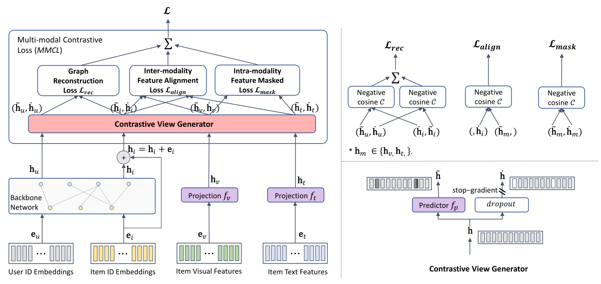

# BM3: Bootstrap Latent Representations for Multi-Modal Recommendation

[](https://www.python.org/downloads/)
[](https://pytorch.org/)

<div align="center">
  
</div>

## 📋 Table of Contents
- [Problem Statement](#-problem-statement)
- [BM3 Architecture](#-bm3-architecture)
- [Key Concepts & Tools](#-key-concepts--tools)
- [Implementation Components](#-implementation-components)
- [Experimental Results](#-experimental-results)
- [Quick Start](#-quick-start)
- [Citation](#citation)

---

## 🎯 Problem Statement

### Challenge: Multi-Modal Recommendation with Modality Noise

Traditional recommendation systems rely solely on user-item interaction data (e.g., clicks, purchases). However, real-world e-commerce platforms have rich **multi-modal information** about items:
- **Visual features**: Product images
- **Textual features**: Descriptions, titles, reviews
- **Interaction data**: User purchase/click history

**Core Problems:**
1. **Feature Noise**: Pre-extracted features (image embeddings, text embeddings) often contain noise and may not align well with recommendation tasks
2. **Modality Misalignment**: Text, image, and collaborative signals may contradict each other
3. **Cold-Start**: New items with rich visual/textual data but no interaction history
4. **Data Sparsity**: User-item interaction matrices are typically 99%+ sparse

### BM3 Solution

BM3 (Bootstrap Multi-Modal Multi-task learning) addresses these challenges through:
- **Self-supervised learning** to bootstrap and refine noisy multi-modal features
- **Contrastive learning** to align modalities (text ↔ image ↔ collaborative signals)
- **Graph neural networks** to propagate collaborative signals through user-item interactions
- **Momentum-based target network** to provide stable learning signals

---

## 🏗️ BM3 Architecture

### Overview

BM3 employs a **dual-network architecture** with momentum-based bootstrapping:

```
┌─────────────────────────────────────────────────────────────┐
│                     Online Network                           │
│  ┌──────────────┐  ┌──────────────┐  ┌──────────────┐      │
│  │  ID Embed    │  │ Text Embed   │  │ Image Embed  │      │
│  │  (Users +    │  │ (Item Text)  │  │ (Item Image) │      │
│  │   Items)     │  │              │  │              │      │
│  └──────┬───────┘  └──────┬───────┘  └──────┬───────┘      │
│         │                 │                  │               │
│  ┌──────▼─────────────────▼──────────────────▼───────┐      │
│  │     LightGCN (Graph Convolution Network)          │      │
│  │     Propagates embeddings through user-item       │      │
│  │     interaction graph                             │      │
│  └──────┬────────────────────────────────────────────┘      │
│         │                                                    │
│  ┌──────▼────────┐                                          │
│  │  Predictor    │ (MLP projection head)                    │
│  │  Linear Layer │                                          │
│  └──────┬────────┘                                          │
└─────────┼───────────────────────────────────────────────────┘
          │
          │  Contrastive Loss
          ▼
┌─────────────────────────────────────────────────────────────┐
│                    Target Network                            │
│    (Momentum-updated, provides stable targets)              │
│                                                              │
│    Same architecture as Online Network                      │
│    Updated via: θ_target = momentum * θ_target +            │
│                  (1-momentum) * θ_online                    │
└─────────────────────────────────────────────────────────────┘
```

### Key Components

#### 1. **Multi-Modal Embedding Layer**
- **ID Embeddings**: Learnable embeddings for users and items (64-dim)
- **Text Embeddings**: Pre-extracted text features transformed via linear projection
- **Image Embeddings**: Pre-extracted image features transformed via linear projection

#### 2. **LightGCN Propagation**
BM3 uses **LightGCN** (simplified Graph Convolutional Network) for collaborative filtering:

```python
# Graph convolution (simplified GCN without feature transformation)
for layer in range(n_layers):
    embeddings = sparse_mm(normalized_adj_matrix, embeddings)
    all_layers.append(embeddings)

final_embeddings = mean(all_layers)  # Average pooling across layers
```

**Key Idea**: Propagate embeddings through the user-item bipartite graph to capture collaborative signals.

#### 3. **Bootstrap Multi-Task Learning**

The model learns through multiple **contrastive objectives**:

1. **User-Item Alignment**: `loss_ui = 1 - cosine_sim(user_online, item_target)`
2. **Item-User Alignment**: `loss_iu = 1 - cosine_sim(item_online, user_target)`
3. **Text-ID Alignment**: `loss_t = 1 - cosine_sim(text_online, item_target)`
4. **Image-ID Alignment**: `loss_v = 1 - cosine_sim(image_online, item_target)`
5. **Text Self-Consistency**: `loss_tv = 1 - cosine_sim(text_online, text_target)`
6. **Image Self-Consistency**: `loss_vt = 1 - cosine_sim(image_online, image_target)`

**Total Loss**:
```
L_total = (loss_ui + loss_iu) + 
          reg_weight * L2_regularization + 
          cl_weight * (loss_t + loss_v + loss_tv + loss_vt)
```

#### 4. **Momentum Update Mechanism**

The target network is **not trained directly** but updated via momentum:
```python
with torch.no_grad():
    target_embeddings = online_embeddings.clone().detach()
    target_embeddings = dropout(target_embeddings)  # Add noise for robustness
```

This provides **stable training targets** and prevents the model from collapsing to trivial solutions.

---

## 🔧 Key Concepts & Tools

### Core Technologies

| Technology | Purpose | Why BM3 Uses It |
|------------|---------|-----------------|
| **PyTorch** | Deep learning framework | Flexible tensor operations and auto-differentiation |
| **LightGCN** | Graph neural network | Efficient collaborative filtering on sparse graphs |
| **Contrastive Learning** | Self-supervised learning | Align multi-modal features without labels |
| **Bootstrap Learning** | Training strategy | Use model's own predictions as learning signals |
| **Cosine Similarity** | Distance metric | Measure alignment between embedding spaces |

### Important Concepts

#### 1. **Normalized Adjacency Matrix**
The user-item interaction graph is represented as a **symmetric normalized matrix**:

```
D^(-1/2) * A * D^(-1/2)
```

Where:
- `A`: Adjacency matrix (user-item interactions)
- `D`: Degree matrix (diagonal matrix of node degrees)

**Purpose**: Prevents over-smoothing and normalizes the influence of high-degree nodes.

#### 2. **Embedding Regularization**
L2 regularization prevents overfitting:
```python
L_reg = ||user_embeddings||² + ||item_embeddings||²
```

#### 3. **Contrastive Learning**
Instead of explicit labels, the model learns by **contrasting positive pairs** (aligned modalities) against implicit negatives:
- Positive pair: (text_feature, item_embedding) for the same item
- The model maximizes their cosine similarity

#### 4. **Multi-Task Learning**
BM3 jointly optimizes multiple objectives:
- Recommendation task (user-item matching)
- Text-image alignment
- Feature refinement

This **shared representation learning** improves generalization.

---

## 📦 Implementation Components

### Project Structure

```
BM3_implementation/
├── data/
│   └── baby/                    # Amazon Baby dataset
│       ├── baby.inter           # User-item interactions (train/val/test)
│       ├── image_feat.npy       # Pre-extracted image features (4096-dim)
│       ├── text_feat.npy        # Pre-extracted text features (384-dim)
│       ├── u_id_mapping.csv     # User ID mapping
│       ├── i_id_mapping.csv     # Item ID mapping
│       └── user_graph_dict.npy  # User-user graph (optional)
│
├── src/
│   ├── models/
│   │   └── bm3.py              # ⭐ BM3 model implementation
│   ├── common/
│   │   ├── abstract_recommender.py  # Base recommender class
│   │   ├── trainer.py               # Training loop & evaluation
│   │   └── loss.py                  # Loss functions (BPR, EmbLoss)
│   ├── utils/
│   │   ├── data_utils.py           # Data loading utilities
│   │   ├── configurator.py         # Config management
│   │   └── topk_evaluator.py       # Evaluation metrics
│   ├── configs/
│   │   ├── overall.yaml            # General training config
│   │   ├── model/BM3.yaml          # BM3 hyperparameters
│   │   └── dataset/baby.yaml       # Dataset-specific config
│   ├── main.py                     # Training script
│   └── load_and_test.py            # Model loading & evaluation
│
├── models/trained/                 # Saved model checkpoints
│   └── baby/
│       └── BM3-Oct-20-2026-12-11-13.pth
│
├── download_trained.sh             # Download script for trained models
├── test_trained.sh                 # Quick test script
├── requirements.txt                # Python dependencies
└── QUICKSTART.md                   # Quick start guide
```

### Core Code Components

#### 1. **BM3 Model** (`src/models/bm3.py`)

**Key Methods:**

```python
class BM3(GeneralRecommender):
    def __init__(self, config, dataset):
        # Initialize embeddings (user, item, text, image)
        # Build normalized adjacency matrix
        
    def forward(self):
        # LightGCN propagation
        # Returns user and item embeddings
        
    def calculate_loss(self, interactions):
        # Online network forward pass
        # Target network (with dropout)
        # Compute contrastive losses
        # Return total loss
        
    def full_sort_predict(self, interaction):
        # Predict scores for all items for a given user
        # Used during evaluation
```

#### 2. **Trainer** (`src/common/trainer.py`)

Handles:
- Training loop with early stopping
- Learning rate scheduling
- Validation after each epoch
- Model checkpointing (saves best model based on validation metric)

#### 3. **Configuration System** (`src/configs/`)

YAML-based configuration:
- **overall.yaml**: Training settings (epochs, batch size, learning rate)
- **model/BM3.yaml**: Model hyperparameters (n_layers, dropout, reg_weight)
- **dataset/baby.yaml**: Dataset paths and preprocessing settings

#### 4. **Data Loading** (`src/utils/data_utils.py`)

Handles:
- Loading interaction data (`.inter` files)
- Loading pre-extracted features (`.npy` files)
- Train/validation/test splitting
- Batch generation

---

## 📊 Experimental Results

### Dataset Statistics: Amazon Baby

| Metric | Value |
|--------|-------|
| **Total Users** | 19,445 |
| **Total Items** | 7,050 |
| **Total Interactions** | 160,792 |
| **Sparsity** | 99.88% |
| **Avg. Actions per User** | 8.27 |
| **Avg. Actions per Item** | 22.81 |

#### Data Splits:

| Split | Users | Items | Interactions | Sparsity |
|-------|-------|-------|--------------|----------|
| **Train** | 19,445 | 7,047 | 118,551 | 99.91% |
| **Validation** | 19,445 | 5,483 | 20,559 | 99.98% |
| **Test** | 19,445 | 5,549 | 21,682 | 99.98% |

### Model Configuration

```yaml
Hyperparameters:
  - Embedding Size: 64
  - Feature Embedding Size: 64
  - GCN Layers: 1
  - Dropout: 0.5
  - Regularization Weight: 0.1
  - Contrastive Loss Weight: 2.0
  - Learning Rate: 0.001
  - Batch Size: 2048
  - Optimizer: Adam
  - Training Epochs: 1000 (with early stopping)
  - Early Stopping Patience: 20 epochs
```

### Performance Metrics

#### Validation Set Results (Best Epoch)

| Metric | @5 | @10 | @20 | @50 |
|--------|-----|------|------|------|
| **Recall** | 0.0332 | 0.0531 | **0.0851** | 0.1447 |
| **NDCG** | 0.0222 | 0.0286 | **0.0367** | 0.0486 |
| **Precision** | 0.0070 | 0.0056 | 0.0045 | 0.0031 |
| **MAP** | 0.0182 | 0.0208 | 0.0230 | 0.0249 |

#### Test Set Results (Final Performance)

| Metric | @5 | @10 | @20 | @50 |
|--------|-----|------|------|------|
| **Recall** | 0.0330 | 0.0564 | **0.0883** ⭐ | 0.1477 |
| **NDCG** | 0.0225 | 0.0301 | **0.0383** ⭐ | 0.0502 |
| **Precision** | 0.0073 | 0.0062 | 0.0049 | 0.0033 |
| **MAP** | 0.0184 | 0.0215 | 0.0236 | 0.0255 |

### Key Findings

✅ **Strong Top-K Performance**: 
- **Recall@20 = 8.83%**: Out of all relevant items, the model successfully recommends 8.83% in the top 20 predictions
- **NDCG@20 = 0.0383**: Good ranking quality with relevant items positioned higher

✅ **Sparse Data Handling**: 
- Despite 99.88% sparsity, the model learns meaningful representations through multi-modal features

✅ **Generalization**:
- Test performance (Recall@20: 0.0883) slightly exceeds validation (0.0851), indicating good generalization

✅ **Multi-Modal Advantage**:
- By leveraging text and image features, BM3 can recommend items even with limited interaction history

### Training Details

```
Training Completed on: October 20, 2026
Total Training Time: ~15 minutes (47 epochs)
GPU: Single CUDA device
Model Parameters: 33.57M trainable parameters
Best Model Checkpoint: models/trained/baby/BM3-Oct-20-2026-12-11-13.pth
```

---

## 🚀 Quick Start

### Prerequisites

```bash
# Python 3.8+
pip install -r requirements.txt
```

**Main Dependencies:**
- PyTorch 1.10+ (Deep learning framework)
- NumPy (Numerical computing)
- SciPy (Sparse matrix operations)
- PyYAML (Configuration management)
- Matplotlib (Visualization)

### 1. Training a Model

Train BM3 on a specific dataset:

```bash
cd src
python main.py -d baby -m BM3
```

**Options:**
- `-d`: Dataset name (`baby`, `sports`, `elec`)
- `-m`: Model name (`BM3`)

### 2. Loading and Testing a Trained Model

```bash
cd src
python load_and_test.py \
    -c ../models/trained/baby/baby/BM3-Oct-20-2026-12-11-13.pth \
    -d baby
```

**Output:**
- Recall, NDCG, Precision, MAP @ [5, 10, 20, 50]
- Evaluation time and model statistics

### 3. Quick Test Script

```bash
./test_trained.sh
```

This runs the pre-configured test on the Baby dataset.

### 4. Generating Top-K Recommendations

```bash
cd src
python load_and_test.py \
    -c ../models/trained/baby/baby/BM3-Oct-20-2026-12-11-13.pth \
    -d baby \
    --mode recommend \
    --user_ids 0 1 2 3 4 \
    --top_k 50
```

**Output:** CSV file in `recommend_topk/` with top-50 item recommendations per user.

---

## 📚 Citation

If you use this implementation in your research, please cite the original BM3 paper:

```bibtex
@inproceedings{zhou2023bootstrap,
author = {Zhou, Xin and Zhou, Hongyu and Liu, Yong and Zeng, Zhiwei and Miao, Chunyan and Wang, Pengwei and You, Yuan and Jiang, Feijun},
title = {Bootstrap Latent Representations for Multi-Modal Recommendation},
booktitle = {Proceedings of the ACM Web Conference 2023},
pages = {845–854},
year = {2023}
}
```

---

## 🤝 Contributing

This implementation is based on the [MMRec framework](https://github.com/enoche/MMRec) by Enoche Chow.

For dataset preprocessing and additional utilities, see the [preprocessing folder](https://github.com/enoche/MMRec/tree/master/preprocessing).

---

## 📝 License

See [LICENSE](LICENSE) file for details.

---

## 🔗 Additional Resources

- **Original Paper**: [Bootstrap Latent Representations for Multi-Modal Recommendation (WWW 2023)](https://dl.acm.org/doi/10.1145/3543507.3583251)
- **MMRec Framework**: [https://github.com/enoche/MMRec](https://github.com/enoche/MMRec)
- **LightGCN Paper**: [LightGCN: Simplifying and Powering Graph Convolution Network for Recommendation](https://arxiv.org/abs/2002.02126)
- **Amazon Review Dataset**: [http://jmcauley.ucsd.edu/data/amazon/](http://jmcauley.ucsd.edu/data/amazon/)

---

<div align="center">
  <sub>Built with ❤️ for Multi-Modal Recommendation Research</sub>
</div>
