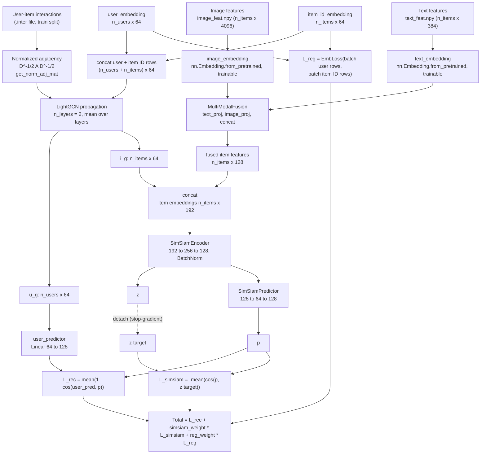

# BM3SimSiam Architecture

This document describes the `BM3SimSiam` model as implemented in this repository. It was written from the source code. Where an older document disagrees with the code, the code is what is described here.

All paths are relative to the repository root. Commands are run from `src/`.

## 1. Overview and motivation

**BM3** (`src/models/bm3.py`, class `BM3`) is a multi-modal recommender. It learns user and item ID embeddings with LightGCN-style graph propagation. It also projects pre-extracted item image and text features into the same space. Training uses no negative sampling and no BPR loss. Instead it minimizes a sum of cosine-distance terms that align an "online" representation, passed through a linear predictor, with a "target" representation. The target is a detached copy of the online representation with dropout applied. The target network is not a separate momentum-updated network. `BM3.calculate_loss` clones the tensors, wraps them in `torch.no_grad()`, and applies `F.dropout`.

**BM3SimSiam** (`src/models/bm3_simsiam.py`, class `BM3SimSiam`) keeps the same graph propagation, data pipeline, trainer and evaluation. It changes the self-supervised part to follow SimSiam:

- Image and text features are projected and concatenated (`MultiModalFusion`) and appended to the graph-propagated item ID embedding.
- The item representation goes through a 3-layer MLP encoder (`SimSiamEncoder`) and a 2-layer MLP predictor (`SimSiamPredictor`), both with BatchNorm.
- The self-supervised loss is the negative cosine similarity between the predictor output `p` and the stop-gradient encoder output `z.detach()`.
- A user-item cosine alignment loss and an embedding regularizer complete the objective.

The SimSiam part is a single-view variant. There are no two augmented views of an item: `p` and `z` are computed from the same input, and no dropout or other augmentation is applied (see section 3.6).

## 2. High-level data flow



The dimensions in the diagram assume `embedding_size = 64`, `feat_embed_dim = 64`, `simsiam_hidden_dim = 64`, `simsiam_output_dim = 128`, and that both modalities are present with the Baby dataset feature sizes (4096 image, 384 text).

## 3. Components

### 3.1 Embedding tables

`BM3SimSiam.__init__` in `src/models/bm3_simsiam.py`:

| Attribute | Type | Shape | Init |
| --- | --- | --- | --- |
| `user_embedding` | `nn.Embedding` | `n_users x embedding_size` | Xavier uniform |
| `item_id_embedding` | `nn.Embedding` | `n_items x embedding_size` | Xavier uniform |
| `text_embedding` | `nn.Embedding.from_pretrained(self.t_feat, freeze=False)` | `n_items x text_dim` | pre-extracted features |
| `image_embedding` | `nn.Embedding.from_pretrained(self.v_feat, freeze=False)` | `n_items x image_dim` | pre-extracted features |

`self.t_feat` and `self.v_feat` are loaded by `GeneralRecommender.__init__` (`src/common/abstract_recommender.py`) from `text_feature_file` and `vision_feature_file` in `data_path/<dataset>/`. Loading happens when `end2end` is false and `is_multimodal_model` is true. If neither file exists, an assertion fails. Because `freeze=False`, the raw features are fine-tuned during training. A missing modality is set to `None` and skipped.

### 3.2 LightGCN-style graph propagation

`get_norm_adj_mat` builds the symmetric bipartite adjacency matrix `A` of size `(n_users + n_items)` squared from the training interactions, then `L = D^(-1/2) A D^(-1/2)` (degree + 1e-7 before the power). It returns a `torch.sparse.FloatTensor` stored as `self.norm_adj`. The code is identical to `BM3.get_norm_adj_mat`.

`forward` propagates only the ID embeddings:

```python
ego = cat(user_embedding.weight, item_id_embedding.weight)   # (n_users+n_items) x 64
layers = [ego]
for _ in range(n_layers):
    ego = torch.sparse.mm(norm_adj, ego)
    layers.append(ego)
all_emb = stack(layers, dim=1).mean(dim=1)                   # mean over n_layers+1 states
u_g, i_g = split(all_emb, [n_users, n_items])
```

The fused image/text features do not pass through the graph. They are concatenated to `i_g` after propagation.

### 3.3 Modality projection (`MultiModalFusion`)

Defined in `src/models/simsiam_modules.py`. It is called through `BM3SimSiam.get_fused_item_features`.

- `text_proj = nn.Linear(text_dim, feat_embed_dim)` and `image_proj = nn.Linear(image_dim, feat_embed_dim)`, both Xavier-normal initialized.
- Output is `cat([text_proj(text), image_proj(image)], dim=-1)`. Text comes first. A missing modality is skipped.
- `BM3SimSiam` constructs it with `output_dim=None`, so no final projection is created. The output width is `fused_feat_dim = 2 * feat_embed_dim = 128` with both modalities, or 64 with one.

These projections are plain linear layers with no nonlinearity or normalization.

### 3.4 Encoder and predictor heads

Both are in `src/models/simsiam_modules.py` and are instantiated in `BM3SimSiam.__init__`.

| Module | Instance | Layers | Shapes (defaults) |
| --- | --- | --- | --- |
| `SimSiamEncoder` | `self.encoder` | `Linear(no bias) -> BatchNorm1d -> ReLU -> Linear(no bias) -> BatchNorm1d -> ReLU -> Linear(no bias) -> BatchNorm1d(affine=False)` | 192 -> 256 -> 256 -> 128. The hidden width is `2 * simsiam_output_dim`. |
| `SimSiamPredictor` | `self.predictor` | `Linear(no bias) -> BatchNorm1d -> ReLU -> Linear(bias)` | 128 -> `simsiam_hidden_dim` (64) -> 128 |
| user head | `self.user_predictor` | `nn.Linear(embedding_size, simsiam_output_dim)`, Xavier normal | 64 -> 128 |

The encoder input size is `item_total_dim = embedding_size + fused_feat_dim` (192 with both modalities). Weights are Xavier-uniform initialized in `_init_weights`.

Users have no encoder. They go straight through `user_predictor`.

### 3.5 Stop-gradient handling

Stop-gradient appears in one place, `BM3SimSiam.calculate_simsiam_loss`:

```python
z = self.encoder(embeddings)
p = self.predictor(z)
z_target = z.detach()
loss = -(F.cosine_similarity(p, z_target, dim=-1).mean())
```

Gradient reaches the encoder and the upstream embeddings only through `p`, not through `z_target`. The user-item loss `calculate_recommendation_loss` has no `detach`, so gradients flow through both sides.

### 3.6 Dropout and augmentation

`BM3SimSiam.__init__` reads `self.dropout = config['dropout']` but never uses it. No dropout or other augmentation is applied anywhere in the forward or loss path. `BM3SimSiam.yaml` sets `dropout: 0.3`, which has no effect on this model. (`BM3` does use it for its target tensors.)

### 3.7 Other modules

`common.loss.SimSiamLoss` exists in `src/common/loss.py` and implements `-cos(prediction, target).mean()`. `BM3SimSiam` does not import or call it. `calculate_simsiam_loss` calls `F.cosine_similarity` directly.

## 4. Forward pass step by step

Notation for the Baby dataset (both modalities): `n_users = 19445`, `n_items = 7050`, image dim 4096, text dim 384. `B` is the batch size (`train_batch_size = 2048`; the last batch may be smaller). Shapes follow from the config values in section 8.

`forward()` returns `(u_g, item_embeddings)` for all users and items:

| Step | Operation | Output shape |
| --- | --- | --- |
| 1 | `get_fused_item_features`: `text_proj(text_embedding.weight)` and `image_proj(image_embedding.weight)`, concatenated | `7050 x 128` |
| 2 | `cat(user_embedding.weight, item_id_embedding.weight)` | `26495 x 64` |
| 3 | `n_layers = 2` sparse multiplications with `norm_adj`, then mean over the 3 states (input and two propagated states) | `26495 x 64` |
| 4 | Split into `u_g` and `i_g` | `19445 x 64`, `7050 x 64` |
| 5 | `item_embeddings = cat([i_g, fused], dim=-1)` | `7050 x 192` |

`forward` also builds a local variable `item_features` (ID embedding concatenated with fused features) that is never used. The comment "residual connection" in the code is also misleading, because step 5 is a concatenation, not an addition.

`calculate_loss(interactions)`: `interactions` is a `2 x B` tensor of `[users; positive items]`, produced by `TrainDataLoader` with `use_neg_sampling: False` (`_get_non_neg_sample`).

| Step | Operation | Output shape |
| --- | --- | --- |
| 1 | `forward()` | as above |
| 2 | `calculate_recommendation_loss`: gather `user_embeddings[users]` and `item_embeddings[items]` | `B x 64`, `B x 192` |
| 3 | `user_pred = user_predictor(batch_user_emb)` | `B x 128` |
| 4 | `item_pred = predictor(encoder(batch_item_emb))` | `B x 128` |
| 5 | `L_rec = (1 - cos(user_pred, item_pred)).mean()` | scalar |
| 6 | `calculate_simsiam_loss(item_embeddings[items])`: `z = encoder(.)`, `p = predictor(z)`, loss `-cos(p, z.detach()).mean()` | `B x 128` -> scalar |
| 7 | `L_reg = EmbLoss(user_embedding.weight[users], item_id_embedding.weight[items])` | scalar |
| 8 | `L_rec + simsiam_weight * L_simsiam + reg_weight * L_reg` | scalar |

The encoder is applied to the same batch rows in steps 4 and 6, so it runs twice per training step. In training mode, BatchNorm uses statistics of those `B` rows, which can contain repeated items.

## 5. Loss functions

`BM3SimSiam.calculate_loss` returns:

```
L = L_rec + simsiam_weight * L_simsiam + reg_weight * L_reg
```

| Term | Method | Formula as implemented | Weight (YAML) |
| --- | --- | --- | --- |
| `L_rec` | `calculate_recommendation_loss` | `mean_b( 1 - cos( user_predictor(u_b), predictor(encoder(i_b)) ) )`. Gradients flow through both arguments. | 1 (fixed) |
| `L_simsiam` | `calculate_simsiam_loss` | `-mean_b( cos( predictor(z_b), stopgrad(z_b) ) )`, with `z_b = encoder(i_b)` | `simsiam_weight: 2.0` |
| `L_reg` | `EmbLoss` in `src/common/loss.py` | `(‖U_b‖₂ + ‖I_b‖₂) / B`, where `U_b` and `I_b` are the batch rows of `user_embedding.weight` and `item_id_embedding.weight`, and the norm is the Frobenius norm of the `B x 64` matrix | `reg_weight: 0.1` |

Here `u_b` is the graph-propagated user embedding (64-d) and `i_b` is the 192-d item embedding. `L_reg` is applied to the raw embedding tables, not to the graph outputs.

Properties of the implementation:

- There is no BPR loss and no negative sampling. `use_neg_sampling: False` is set in `BM3SimSiam.yaml`.
- There are no per-modality alignment losses. BM3's `loss_t`, `loss_v`, `loss_tv` and `loss_vt` have no counterpart. Image and text features influence training only through the fused part of the item embedding.
- `L_simsiam` lies in `[-1, 1]` (minimum -1 when `p` and `z` point the same way). `L_rec` lies in `[0, 2]`.
- The SimSiam term has no second view and no symmetrization.

## 6. Differences from the original BM3

Only differences verified in `src/models/bm3.py`, `src/models/bm3_simsiam.py`, and the two model YAML files:

| Aspect | `BM3` | `BM3SimSiam` |
| --- | --- | --- |
| Item output of `forward` | `i_g + item_id_embedding.weight` (64-d, residual add) | `cat([i_g, fused_features])` (192-d) |
| Modality handling | Separate `image_trs` and `text_trs` (`Linear` to `embedding_size`), each with its own loss terms | `MultiModalFusion` (two `Linear` layers, concatenated) merged into the item embedding. No per-modality losses. |
| Predictor | One `nn.Linear(64, 64)` shared by users, items, text and image | Items: `SimSiamEncoder` then `SimSiamPredictor` (MLPs with BatchNorm). Users: `nn.Linear(64, 128)`. |
| Target for alignment | Clone of the online tensor, `F.dropout(p=dropout)` inside `torch.no_grad()`, then `.detach()` at use. No EMA update. | `z.detach()` of the encoder output, no dropout |
| Loss terms | `loss_ui`, `loss_iu`, `loss_t`, `loss_v`, `loss_tv`, `loss_vt` (all `1 - cos`), plus regularization | `L_rec` (`1 - cos`), `L_simsiam` (`-cos`), regularization |
| Stop-gradient on user-item loss | Yes, on the target side of `loss_ui` and `loss_iu` | No. `L_rec` backpropagates through both sides. |
| Loss weights | `cl_weight` (2.0) on the four modality terms, `reg_weight` (0.1) | `simsiam_weight` (2.0), `reg_weight` (0.1) |
| Regularization input | `EmbLoss(u_online_ori, i_online_ori)`: all users and all items, graph output | `EmbLoss(user_embedding.weight[users], item_id_embedding.weight[items])`: batch rows of raw tables |
| `dropout` hyperparameter | Used (0.3) | Read but unused |
| `feat_embed_dim` | Not used. Code sets `feat_embed_dim = embedding_size`. | Read from config (64) |
| BatchNorm | None | In encoder and predictor, so `train()` and `eval()` behave differently |
| Scoring | `predictor(u) @ predictor(i).T` | `user_predictor(u) @ predictor(encoder(i)).T` |

Unchanged: normalized adjacency construction, LightGCN propagation with mean over layers, `GeneralRecommender` base class, trainer, optimizer settings, data loading, and evaluation.

## 7. Inference and scoring

`BM3SimSiam.full_sort_predict(interaction)`:

```python
user_embeddings, item_embeddings = self.forward()
user_pred = self.user_predictor(user_embeddings[user])      # (n_batch_users, 128)
item_pred = self.predictor(self.encoder(item_embeddings))   # (n_items, 128)
score_mat = torch.matmul(user_pred, item_pred.transpose(0, 1))  # (n_batch_users, n_items)
```

The score is a raw dot product, while training uses cosine similarity. The encoder runs over all items at once, using BatchNorm running statistics because `Trainer.evaluate` calls `self.model.eval()`.

Full-ranking evaluation (`Trainer.evaluate` in `src/common/trainer.py`, run under `@torch.no_grad()`):

1. `EvalDataLoader` yields `[batch_users, mask_matrix]` for users in the validation or test split. The mask lists each user's training positives. Each `EvalDataLoader` is built with `additional_dataset=train_dataset`.
2. `scores = model.full_sort_predict(batch)` gives scores for all items.
3. Training positives are masked: `scores[masked_items[0], masked_items[1]] = -1e10`.
4. `torch.topk(scores, max(topk))` with `topk = [5, 10, 20, 50]` takes the top 50 per user.
5. `TopKEvaluator.evaluate` (`src/utils/topk_evaluator.py`) computes the metrics `Recall`, `NDCG`, `Precision` and `MAP` at each k, averaged over users.

`filter_out_cod_start_users: True` drops users from the validation and test splits if they have no interactions in the training split (`RecDataset.split` in `src/utils/dataset.py`).

During training, `Trainer.fit` evaluates on both validation and test after every epoch (`eval_step: 1`). It uses `valid_metric: Recall@20` for early stopping and checkpointing. The test result recorded is the one from the best validation epoch.

## 8. Hyperparameters

Configuration is merged in order: `src/configs/overall.yaml`, `src/configs/dataset/<dataset>.yaml`, `src/configs/model/<model>.yaml` (`Config._load_dataset_model_config`). Later files override earlier ones.

### Model (`src/configs/model/BM3SimSiam.yaml`)

| Name | Value | Meaning |
| --- | --- | --- |
| `embedding_size` | 64 | Width of user and item ID embeddings. Also set in `overall.yaml`. |
| `feat_embed_dim` | 64 | Output width of each modality projection in `MultiModalFusion`. Code fallback if absent: 64. |
| `n_layers` | 2 | LightGCN propagation layers |
| `dropout` | 0.3 | Read by the model but unused |
| `reg_weight` | 0.1 | Weight of `L_reg` |
| `simsiam_weight` | 2.0 | Weight of `L_simsiam`. Code fallback if absent: 1.0. |
| `simsiam_hidden_dim` | 64 | Hidden width of `SimSiamPredictor`. Code fallback: 64. |
| `simsiam_output_dim` | 128 | Output width of encoder and predictor, and of `user_predictor`. Encoder hidden width is twice this value. Code fallback: 128. |
| `use_neg_sampling` | False | Disables negative sampling in the training loader. Overrides `True` in `overall.yaml`. |
| `hyper_parameters` | `[]` | No grid search. `quick_start` adds `seed`. |

For comparison, `BM3.yaml` has the same `embedding_size`, `feat_embed_dim`, `n_layers`, `dropout`, `reg_weight`, `use_neg_sampling` and `hyper_parameters` values, plus `cl_weight: 2.0`.

### General (`src/configs/overall.yaml`)

| Name | Value | Meaning |
| --- | --- | --- |
| `seed` | `[999]` | Random seed list. Each entry runs once. |
| `use_gpu`, `gpu_id` | `True`, `0` | Device selection. Falls back to CPU if CUDA is unavailable. |
| `epochs` | 75 | Maximum training epochs |
| `stopping_step` | 10 | Early-stopping patience, in evaluations |
| `train_batch_size` | 2048 | Interactions per training batch |
| `eval_batch_size` | 4096 | Users per evaluation batch |
| `learner` | `adam` | Optimizer |
| `learning_rate` | 0.001 | Initial learning rate |
| `learning_rate_scheduler` | `[1.0, 50]` | Gives factor `1.0 ** (epoch / 50)`, a constant learning rate |
| `eval_step` | 1 | Evaluate every epoch |
| `metrics` | `Recall, NDCG, Precision, MAP` | Reported metrics |
| `topk` | `[5, 10, 20, 50]` | Cutoffs |
| `valid_metric` | `Recall@20` | Early-stopping and checkpoint criterion |
| `is_multimodal_model` | `True` | Enables loading of feature files |
| `end2end` | `False` | Uses pre-extracted features |
| `inter_splitting_label` | `x_label` | Column holding the split (0 train, 1 validation, 2 test) |
| `checkpoint_dir` | `saved` | Where `Trainer` writes `<model>-<dataset>-<time>.pth` |

`clip_grad_norm` is not set in any YAML, so `Config.__getitem__` returns `None` and gradient clipping is off.

### Dataset (`src/configs/dataset/{baby,sports,elec}.yaml`)

The three files have the same structure and differ only in `inter_file_name`:

| Name | Value |
| --- | --- |
| `USER_ID_FIELD`, `ITEM_ID_FIELD`, `TIME_FIELD` | `userID`, `itemID`, `timestamp` |
| `inter_file_name` | `baby.inter`, `sports.inter` or `elec.inter` |
| `vision_feature_file` | `image_feat.npy` |
| `text_feature_file` | `text_feat.npy` |
| `user_graph_dict_file` | `user_graph_dict.npy` (listed in the config, not used by `BM3SimSiam`) |
| `field_separator` | tab |
| `filter_out_cod_start_users` | `True` |

The Baby data in `data/baby/` has 19,445 users, 7,050 items and 160,792 interactions. Its `image_feat.npy` is `7050 x 4096` and `text_feat.npy` is `7050 x 384`. Dimensions for Sports and Elec depend on their feature files.

## 9. Training and evaluation

Run from `src/`, because `data_path` is `../data/`.

Train (arguments from `src/main.py`: `--model/-m`, default `BM3`; `--dataset/-d`, default `baby`):

```bash
cd src
python main.py -d baby -m BM3SimSiam
```

`main.py` calls `quick_start(model, dataset, config_dict={'gpu_id': 0}, save_model=True)`. `get_model` in `src/utils/utils.py` maps the name `BM3SimSiam` to the module `models.bm3_simsiam` and the class `BM3SimSiam`. The best-validation checkpoint is written to `saved/BM3SimSiam-<dataset>-<timestamp>.pth` and logs go to `src/log/`.

Evaluate a checkpoint or produce recommendations (arguments from `src/load_and_test.py`: `-c/--checkpoint` required, `-d/--dataset` in `baby|sports|elec`, `--mode` in `test|recommend`, `--user_ids`, `--top_k`):

```bash
python load_and_test.py -c saved/BM3SimSiam-baby-<timestamp>.pth -d baby
python load_and_test.py -c saved/BM3SimSiam-baby-<timestamp>.pth -d baby \
    --mode recommend --user_ids 0 1 2 3 4 --top_k 20
```

The module-level smoke tests `python models/simsiam_modules.py` (from `src/`), `python test_simsiam_integration.py` and `python test_bm3simsiam.py` print shape checks. They have no assertions or test runner.

## 10. File map

| File | Role |
| --- | --- |
| `src/models/bm3_simsiam.py` | `BM3SimSiam`: `__init__`, `get_norm_adj_mat`, `get_fused_item_features`, `forward`, `calculate_simsiam_loss`, `calculate_recommendation_loss`, `calculate_loss`, `full_sort_predict` |
| `src/models/simsiam_modules.py` | `SimSiamEncoder`, `SimSiamPredictor`, `MultiModalFusion` |
| `src/models/bm3.py` | Original `BM3`, for comparison |
| `src/common/abstract_recommender.py` | `GeneralRecommender`: sizes, device and feature loading (`v_feat`, `t_feat`) |
| `src/common/loss.py` | `EmbLoss` (used), `SimSiamLoss` (defined, not used by the model), `BPRLoss`, `L2Loss` |
| `src/common/trainer.py` | `Trainer`: `fit`, `_train_epoch`, `evaluate`, optimizer, scheduler, checkpointing |
| `src/utils/quick_start.py` | `quick_start`: config, data, model and trainer wiring |
| `src/utils/utils.py` | `get_model`, `get_trainer`, `init_seed`, `early_stopping` |
| `src/utils/configurator.py` | `Config`: YAML merge, device selection |
| `src/utils/dataset.py` | `RecDataset`: loading, train/validation/test split |
| `src/utils/dataloader.py` | `TrainDataLoader`, `EvalDataLoader` |
| `src/utils/topk_evaluator.py`, `src/utils/metrics.py` | Top-k metric computation |
| `src/configs/overall.yaml` | General training and evaluation settings |
| `src/configs/model/BM3SimSiam.yaml` | Model hyperparameters |
| `src/configs/dataset/{baby,sports,elec}.yaml` | Dataset file names and field names |
| `src/main.py` | Training entry point |
| `src/load_and_test.py` | Checkpoint evaluation and top-k recommendation |
